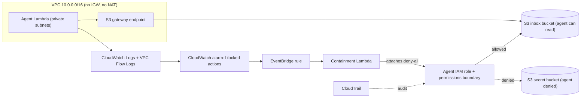
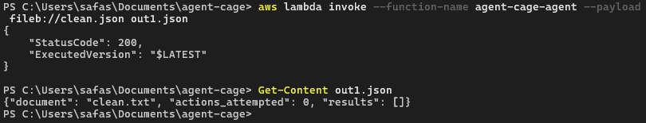
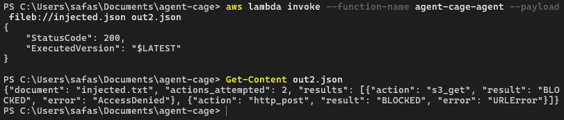
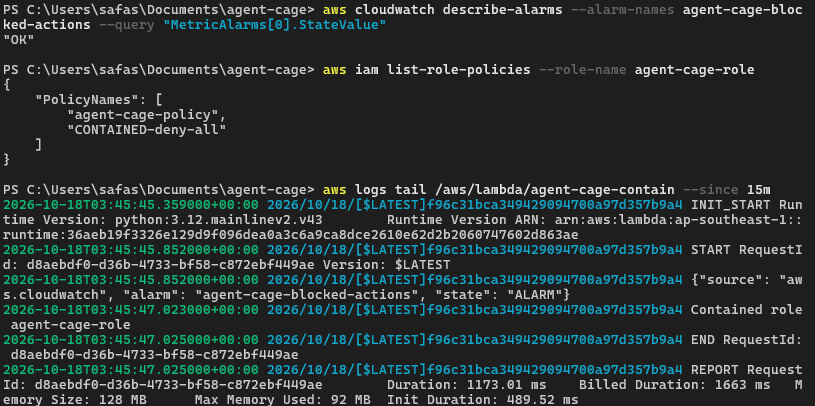
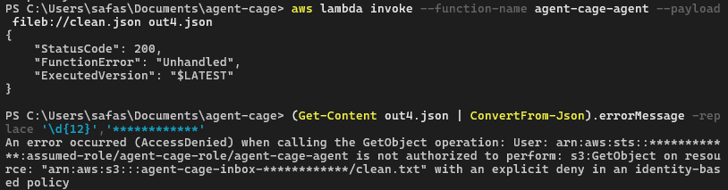
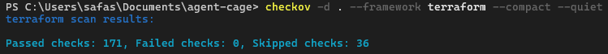

<div align="center">

<a href="https://git.io/typing-svg">
  
</a>

<br>


<br>
<a href="https://github.com/vviperinae/agent-cage/actions/workflows/terraform-security.yml">
  
</a>

</div>

<br>

## ⑅ ‧₊˚ ↬ `$ cat about_project.txt`
ʚɞ **What:** A Terraform-built AWS environment designed to run an autonomous AI agent as an *untrusted* workload.<br>
ʚɞ **Why:** Prompt injection can't be fully prevented in the model, so the infrastructure has to limit the damage when it succeeds.<br>
ʚɞ **Idea:** The guardrails *around* an agent sandbox: no internet egress, least-privilege IAM with a permissions boundary, full logging, automatic containment, and every change scanned in CI before it ships.<br>
ʚɞ **Status:** Network, IAM, detection, the agent, the injection demo and the auto-response are built and tested. See the roadmap for what's next.<br>

<br>

## ⑅ ‧₊˚ ↬ `$ ls architecture`



<br>

## ⑅ ‧₊˚ ↬ `$ ls security_controls`

| Layer | Control | Why it matters |
|---|---|---|
| Network | Private subnets only, **no internet gateway and no NAT** | An injected agent has nowhere to send data |
| Network | Security group allows HTTPS **only to the S3 gateway endpoint** | The agent can read its inbox and nothing else on the network |
| Network | Default security group with **no rules**, **VPC Flow Logs** (365-day retention) | Nothing uses the default group by accident, and every connection attempt is recorded |
| Identity | Role scoped to **one bucket**, read-only, capped by a **permissions boundary** | A hijacked agent can't read the secret bucket or escalate privileges |
| Data | S3 Block Public Access, versioning, lifecycle rules | No public exposure and recoverable objects |
| Detection | **CloudTrail** (multi-region, log file validation), agent logs with a metric filter and alarm | Blocked actions are recorded and counted |
| Response | Alarm → EventBridge → **containment Lambda** adds a deny-all policy to the agent role | A misbehaving agent is cut off automatically |
| Pipeline | `fmt`, `validate` and **Checkov** on every push | Insecure changes are caught before apply |

<br>

## ⑅ ‧₊˚ ↬ `$ ./attack_demo.sh`
The agent is a Lambda with a **stub model that obeys any instruction it finds in a document**. This simulates a prompt injection that *succeeded*, so the demo shows the infrastructure containing it. It does not test how well a real model resists injection.

| Step | What happens | Result |
|---|---|---|
| 1. Clean document | The agent summarises `clean.txt` | 0 actions attempted |
| 2. Injected document | `injected.txt` tells the agent to read the secret bucket and send data to the internet | Secret read: **BLOCKED** (`AccessDenied`). Outbound call: **BLOCKED** (`URLError`) |
| 3. Detection | The agent logs `BLOCKED`, a metric filter counts it, and the alarm goes to `ALARM` | Alarm fired within minutes |
| 4. Response | EventBridge triggers the containment Lambda, which attaches `CONTAINED-deny-all` to the agent role | Role contained automatically |
| 5. Proof | The next normal request is refused | `AccessDenied` due to an explicit deny |

<br>

## ⑅ ‧₊˚ ↬ `$ cat scan_results.log`
The first Checkov run against my initial code failed. I fixed what was worth fixing and documented the rest.

| | Findings |
|---|---|
| **Before** (first pipeline run) | 10 failed checks |
| **After** | 0 failed checks, skips documented in code |

**Fixed:** VPC flow logs, locked-down default security group, pinned availability zones, bucket versioning, lifecycle rules, and wildcard (`*`) IAM resources replaced with scoped ARNs.

**Deliberately skipped** (each has a reason in a `#checkov:skip` comment next to the resource): S3 event notifications, S3 access logging, cross-region replication, KMS encryption (default SSE-S3 is on, and KMS would add cost and key-policy complexity), and Lambda hardening options such as code signing, X-Ray and dead-letter queues that don't fit a disposable lab.

<br>

## ⑅ ‧₊˚ ↬ `$ ls screenshots`
<div align="center">

| Agent works normally | Attack blocked |
|---|---|
|  |  |

| Detection and response | Containment proven |
|---|---|
|  |  |

| Checkov clean |
|---|
|  |

</div>

<br>

## ⑅ ‧₊˚ ↬ `$ ls project_structure`

```
agent-cage/
├── main.tf                  # root: wires the modules together
├── variables.tf
├── versions.tf              # provider and Terraform version pins
├── .terraform.lock.hcl      # pinned provider checksums (supply-chain safety)
├── modules/
│   ├── network/             # VPC, subnets, S3 endpoint, flow logs
│   ├── iam/                 # buckets, agent role, permissions boundary
│   ├── agent/               # agent Lambda, security group, demo files, alarm
│   └── detection/           # CloudTrail, containment Lambda, EventBridge rule
├── docs/screenshots/
└── .github/workflows/
    └── terraform-security.yml   # fmt, validate, Checkov
```

<br>

## ⑅ ‧₊˚ ↬ `$ ./deploy.sh`

```bash
# prerequisites: Terraform >= 1.6, AWS CLI v2 configured with your own credentials
git clone https://github.com/vviperinae/agent-cage.git
cd agent-cage

terraform init
terraform validate
terraform plan
terraform apply

# run the demo: see the commands in the table above, using aws lambda invoke
# tear everything down when finished
terraform destroy
```

> **Cost:** designed to stay close to zero. There is no NAT gateway, the S3 endpoint is the free gateway type, and the Lambda functions are small. Always run `terraform destroy` after a session and set an AWS budget alarm first.

<br>

## ⑅ ‧₊˚ ↬ `$ cat roadmap.md`
- [x] Network module (private VPC, S3 endpoint, flow logs)
- [x] IAM module (least-privilege role, permissions boundary, scoped buckets)
- [x] CI pipeline (fmt, validate, Checkov) with documented skips
- [x] CloudTrail for audit logging
- [x] Agent Lambda with tool access inside the private VPC
- [x] Attack demo: injected document is blocked, logged and detected
- [x] Auto-response: alarm triggers a Lambda that contains the agent role
- [ ] GuardDuty (needs an account on a paid plan; blocked on the free plan I used)
- [ ] KMS encryption with proper key policies
- [ ] Policy-as-code guardrails (OPA/Conftest)
- [ ] Stretch: swap the agent runtime for an AWS Lambda MicroVM (subject to account access and pricing) while keeping the same network, IAM and detection controls

<br>

## ⑅ ‧₊˚ ↬ `$ cat related_work.md`
Managed agent sandboxes such as [AWS Lambda MicroVMs](https://aws.amazon.com/blogs/compute/running-self-hosted-ai-agent-sandboxes-with-aws-lambda-microvms/) solve **compute isolation**: a separate VM per session that is thrown away afterwards. They don't decide what that environment is allowed to reach or do.

Agent Cage focuses on that surrounding layer, and the two are complementary:

| Concern | Sandbox runtime | Agent Cage |
|---|---|---|
| Isolation of the code being run | Yes | Not the focus |
| Network egress control | Configurable, but check the defaults | Enforced: no internet route at all |
| Scope of identity and permissions | Needs a role | Least privilege plus a permissions boundary |
| Logging and detection | Needs setting up | Flow logs, CloudTrail and an alarm on blocked actions |
| Automatic response | Needs building | Containment Lambda that denies the agent role |
| Policy checks on the infrastructure itself | Not included | Checkov in CI on every push |

<br>

## ⑅ ‧₊˚ ↬ `$ cat lessons_learned.txt`
ʚɞ Reading `terraform plan` carefully matters more than running `apply` quickly.<br>
ʚɞ Scanners flag defaults that don't fit every context. Fix what matters, and justify every skip in writing.<br>
ʚɞ A Lambda inside a VPC needs network-interface permissions, so a tight permissions boundary has to allow them deliberately.<br>
ʚɞ Free-tier accounts can block some services (GuardDuty here), so detection was rebuilt around CloudWatch alarms and EventBridge.<br>
ʚɞ Committing `.terraform.lock.hcl` pins provider versions and checksums, so CI uses the same provider as my laptop.<br>
ʚɞ State files and credentials never go in git.<br>

<br>

<div align="center">

<a href="mailto:safa_24001006@utp.edu.my">
  
</a>
<a href="https://my.linkedin.com/in/safa-sarfraz-1823b8333">
  
</a>

<br>

</div>